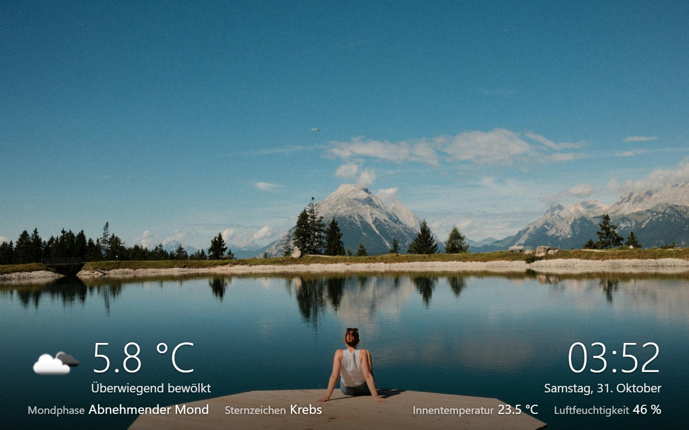
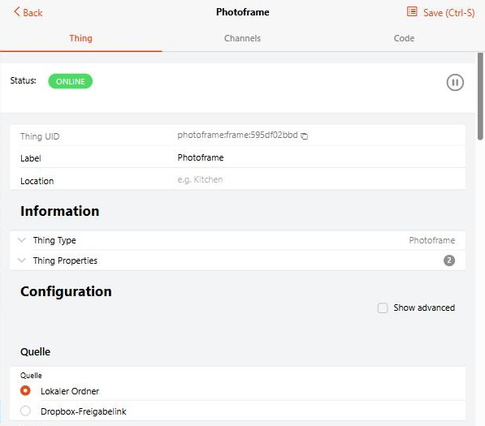
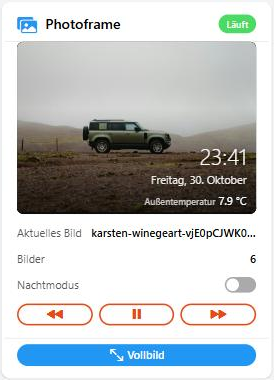

# Photoframe Binding

## Your photo frame inside the openHAB app: Android, iOS or browser, no kiosk app needed

Stay in your app. The slideshow runs full screen right where you use openHAB, in the Android app, in the iOS app and in any browser.
A tap brings you to the openHAB page you chose, and after a set time without touch the slideshow returns by itself.

**Coming soon:** Nextcloud, Dropbox login and Google Drive support.

This binding turns openHAB into a digital photo frame.
Everything runs inside the binding: no scripts, no ImageMagick, no cron jobs, nothing extra to install on the server.

- **One folder = one photo frame:** the binding creates the folder, you put pictures in
- Pictures from a local folder or a shared Dropbox folder
- Transitions (fade, slide, wipe, zoom), Ken Burns effect
- Blurred background for pictures that do not fit the screen format, correct orientation (EXIF)
- Overlays: clock, date, weather with icon, item values such as temperatures, caption from the file name
- Night mode: black screen, dimmed pictures, or black with a dimmed clock
- All screens show the same picture; play, pause, next and previous from openHAB
- A tap opens openHAB on top of the slideshow, or another app, and the slideshow returns by itself

The binding requires **openHAB 5.0 or later**. It does not start on openHAB 4.x.

| Slideshow (portrait picture with blurred background) | Thing configuration | Dashboard widget |
|---|---|---|
|  |  |  |

> **Test version:** Versions 0.x are test versions. Local folder and shared Dropbox links work and are tested; Nextcloud, Dropbox login and Google Drive follow.
> Please report problems and ideas as [GitHub issue](https://github.com/pierrecinema/openhab-binding-photoframe/issues).

🇩🇪 Deutsche Anleitung: [docs/ANLEITUNG.md](docs/ANLEITUNG.md).

## Installation

1. Download `org.openhab.binding.photoframe-<version>.jar` from the [latest release](https://github.com/pierrecinema/openhab-binding-photoframe/releases).
1. Copy it into the `addons` folder of openHAB:

   | Installation             | Folder                                                               |
   |--------------------------|----------------------------------------------------------------------|
   | Docker (official image)  | `/openhab/addons` in the container (usually a volume on the host)    |
   | openHABian / apt / rpm   | `/usr/share/openhab/addons`                                          |
   | Manual (zip)             | `<openhab>/addons`                                                   |

   Docker example: `docker cp org.openhab.binding.photoframe-<version>.jar openhab:/openhab/addons/`
1. After 10 to 30 seconds the binding is loaded. A restart is not needed.

**Update:** delete the old JAR from the `addons` folder and copy the new one. Things and items are kept.

## Quick Start

1. Go to **Settings → Things → + → Photoframe Binding** and add a **Photoframe** thing with the source **Local folder**.
1. Put pictures into the folder, by default `userdata/photoframe` (Docker: `/openhab/userdata/photoframe`).
   The binding creates the folder. New pictures appear after at most 5 minutes.
1. Link the channels: open the thing, tab **Channels**, then **Add Equipment to Model** or link single channels.
   You need at least **Slideshow Address** (`pageUrl`).
1. Open the address from `pageUrl` in a browser, on a tablet or PC. A tap switches to full screen.

### Pictures from Dropbox

1. In Dropbox, create a folder for the photo frame and put pictures into it.
1. **Share** the folder → **Copy link** (a link like `https://www.dropbox.com/scl/fo/...`).
1. In the Photoframe thing select the source **Dropbox shared folder link** and paste the link into **Shared Link**.

The folder is read every 60 minutes; the `refresh` channel reads it immediately.
Anyone who knows a shared link can see the pictures, so only use it for pictures that may be seen this way.

## Supported Things

| Thing   | Type  | Description                                               |
|---------|-------|-----------------------------------------------------------|
| `frame` | Thing | One photo frame: a picture folder with its own slideshow  |

Several `frame` things are possible, each with its own folder, settings and address.
One thing can serve any number of screens; they all show the same picture at the same time.

## Discovery

Discovery is not supported. Add the `frame` thing manually.

## Binding Configuration

The binding itself has no configuration.

## Thing Configuration

### Source

| Name             | Type    | Description                                                                 | Default | Required | Advanced |
|------------------|---------|-----------------------------------------------------------------------------|---------|----------|----------|
| `sourceType`     | text    | `LOCAL` (local folder) or `DROPBOX_LINK` (shared Dropbox folder link)       | `LOCAL` | yes      | no       |
| `localFolder`    | text    | Folder with the pictures, empty means `userdata/photoframe`                 | (empty) | no       | no       |
| `link`           | text    | Shared folder link from Dropbox                                             | N/A     | no       | no       |
| `refreshMinutes` | integer | Minutes between reading the folder, 0 uses the default of the source (local 5, Dropbox 60) | 0 | no | yes |

Supported picture formats: JPEG, PNG, GIF and BMP. Subfolders are not read.

### Slideshow

| Name                | Type    | Description                                                                 | Default  | Required | Advanced |
|---------------------|---------|-----------------------------------------------------------------------------|----------|----------|----------|
| `interval`          | integer | Seconds each picture is shown (5 to 3600)                                   | 30       | no       | no       |
| `order`             | text    | `RANDOM` or `NAME`                                                          | `RANDOM` | no       | no       |
| `transition`        | text    | `FADE`, `SLIDE`, `WIPE`, `ZOOM`, `RANDOM` or `NONE`                         | `FADE`   | no       | no       |
| `transitionSeconds` | decimal | Duration of the transition (0.5 to 5)                                       | 1.5      | no       | no       |
| `kenBurns`          | boolean | Slowly zoom and pan while a picture is shown                                | true     | no       | no       |
| `fitMode`           | text    | `BLUR` (fit, blurred background), `FIT` (black borders), `FILL` (crop), `AUTO` | `BLUR` | no       | no       |
| `maxSize`           | integer | Longest side of the pictures sent to the screen (640 to 4096)               | 1920     | no       | yes      |
| `tapPage`           | text    | Main UI page or sitemap opened on top of the slideshow by a tap, chosen from a list; takes priority over `tapUrl` | (empty) | no | no |
| `tapUrl`            | text    | Address opened by a tap, empty switches to full screen                      | (empty)  | no       | yes      |
| `returnSeconds`     | integer | Seconds without touch until the slideshow returns over an openHAB page, 0 keeps the page open | 120 | no | yes |
| `baseUrl`           | text    | Address of openHAB as seen from the screens, empty detects it               | (empty)  | no       | yes      |
| `cacheSizeMb`       | integer | Size of the picture cache                                                   | 500      | no       | yes      |

### Overlays

| Name           | Type | Description                                                  | Default | Required | Advanced |
|----------------|------|--------------------------------------------------------------|---------|----------|----------|
| `clock`        | text | `NONE`, `TIME` or `TIME_DATE`                                | `NONE`  | no       | no       |
| `overlayItems` | text | Up to 4 items whose label and value are shown on the picture; image items are shown as picture | (empty) | no | no |
| `weatherIconItem` | text | Image item with the weather icon, shown at the bottom left | (empty) | no | no |
| `weatherTemperatureItem` | text | Item with the temperature, shown large at the bottom left | (empty) | no | no |
| `weatherTextItem` | text | Item with the weather as text, shown below the temperature | (empty) | no | no |
| `caption`      | text | `NONE` or `FILENAME`                                         | `NONE`  | no       | no       |

### Night Mode

| Name         | Type | Description                                            | Default | Required | Advanced |
|--------------|------|--------------------------------------------------------|---------|----------|----------|
| `nightMode`  | text | `OFF`, `BLACK`, `DIM` or `CLOCK` (black, dimmed clock) | `OFF`   | no       | no       |
| `nightStart` | text | Start time in `HH:mm`                                  | `22:00` | no       | no       |
| `nightEnd`   | text | End time in `HH:mm`                                    | `06:30` | no       | no       |

During the night a tap wakes the slideshow for 30 seconds.

## Channels

| Channel        | Type     | Read/Write | Description                                                                       |
|----------------|----------|------------|-----------------------------------------------------------------------------------|
| `control`      | Player   | R/W        | Play, pause, next and previous picture                                            |
| `currentImage` | String   | R          | File name of the picture currently shown                                          |
| `imageCount`   | Number   | R          | Number of pictures in the folder                                                  |
| `pageUrl`      | String   | R          | Address of the slideshow page                                                     |
| `night`        | Switch   | R/W        | Night mode active; a command forces it until the next start or end time           |
| `lastRefresh`  | DateTime | R          | Time the folder was read successfully (advanced)                                  |
| `refresh`      | Switch   | W          | ON reads the folder again now (advanced)                                          |

## Actions

| Action       | Description                                                                              |
|--------------|------------------------------------------------------------------------------------------|
| `next()`     | Shows the next picture                                                                   |
| `previous()` | Shows the previous picture                                                               |
| `pause()`    | Pauses the slideshow                                                                     |
| `play()`     | Continues the slideshow                                                                  |
| `refresh()`  | Reads the folder again now                                                               |
| `newToken()` | Creates a new access token and returns the new address; addresses with the old token stop working |

```java
val frame = getActions("photoframe", "photoframe:frame:living")
frame.next()
```

## Full Example

### Thing Configuration

```java
Thing photoframe:frame:living "Photoframe Living Room" [ sourceType="LOCAL", interval=30, transition="FADE", kenBurns=true, fitMode="BLUR", clock="TIME_DATE", overlayItems="Outdoor_Temperature", nightMode="CLOCK", nightStart="22:30", nightEnd="06:30" ]
```

With Dropbox as source:

```java
Thing photoframe:frame:holiday "Photoframe Holiday" [ sourceType="DROPBOX_LINK", link="https://www.dropbox.com/scl/fo/...", interval=20 ]
```

### Item Configuration

```java
Player   Photoframe_Control  "Photoframe"                 { channel="photoframe:frame:living:control" }
String   Photoframe_Picture  "Current picture [%s]"       { channel="photoframe:frame:living:currentImage" }
Number   Photoframe_Count    "Pictures [%d]"              { channel="photoframe:frame:living:imageCount" }
String   Photoframe_Url      "Slideshow address [%s]"     { channel="photoframe:frame:living:pageUrl" }
Switch   Photoframe_Night    "Night mode"                 { channel="photoframe:frame:living:night" }
Switch   Photoframe_Refresh  "Read folder now"            { channel="photoframe:frame:living:refresh" }
DateTime Photoframe_Updated  "Read [%1$tF %1$tR]"         { channel="photoframe:frame:living:lastRefresh" }
```

### Sitemap Configuration

A sitemap shows the slideshow below the title of the app, not in full screen.
For full screen use the Main UI page below.

```perl
sitemap photoframe label="Photoframe" {
    Webview url="http://192.168.1.10:8080/photoframe/living/?token=<token>" height=12
    Default item=Photoframe_Control
    Text item=Photoframe_Picture
}
```

### Rule Configuration

```java
rule "Pause the photo frame when nobody is home"
when
    Item Presence changed to OFF
then
    Photoframe_Control.sendCommand(PAUSE)
end
```

## Dashboard Widget

A ready-made card for Main UI shows a live preview, the current picture, the number of pictures and the night mode, with buttons for previous, play/pause, next and full screen.
Texts are available in English and German.


Installation:

1. Open **Developer Tools → Widgets → +** in Main UI.
1. Replace the content with [widgets/photoframe_card.yaml](widgets/photoframe_card.yaml) and save.
1. On a page, add the widget **photoframe_card** (under "Personal widgets") and select your items in its properties.
   `nightItem` is optional. A `previewHeight` of 0 hides the preview.

Example configuration on a page:

```yaml
component: widget:photoframe_card
config:
  lang: de
  urlItem: Photoframe_Url
  controlItem: Photoframe_Control
  countItem: Photoframe_Count
  currentImageItem: Photoframe_Picture
  nightItem: Photoframe_Night
```

## Full-Screen Page in Main UI

The slideshow can run as a page of Main UI without title bar, for example on a tablet that shows openHAB in a browser.

1. Go to **Settings → Pages → + → Create Layout Page** and save the empty page.
1. Open the tab **Code** of the page and replace the content with the following YAML.
   Copy `<id>` and `<token>` from the slideshow address.

```yaml
component: oh-layout-page
config:
  label: Photoframe
  sidebar: true
  icon: screen
  layoutType: fixed
  fixedType: grid
  hideNavbar: true
  hideSidebarIcon: true
  colNum: 1
  margin: 0
slots:
  grid:
    - component: oh-grid-item
      config:
        x: 0
        y: 0
        w: 1
        h: 1
      slots:
        default:
          - component: iframe
            config:
              src: /photoframe/<id>/?token=<token>&tap=%2F
              style:
                position: fixed
                top: "0"
                left: "0"
                width: 100vw
                height: 100vh
                border: "0"
                zIndex: "5000"
                background: "#000"
```

`&tap=%2F` opens openHAB on top of the slideshow when the page is tapped.
To use **Page on Tap** instead, leave `&tap=%2F` out, because `&tap=` overrides the settings of the thing.
With a pinned Main UI sidebar on a large screen, the sidebar stays above the left part of the picture.
The page uses a plain HTML element that is not an official Main UI component, so it may need a change after an openHAB update.

## Screens and Tablets

The slideshow is a normal web page. Any device with a browser can show it.

### As Tablet Screensaver

Two ways with [Fully Kiosk Browser](https://www.fully-kiosk.com) (Android). Menu names can differ slightly between versions.

**A – free version: slideshow as start page, back to it when idle**

1. Fully Kiosk → Settings → **Web Content Settings → Start URL**: the slideshow address.
1. In the Photoframe thing set **Tap Address** (advanced) to your openHAB page, e.g. `http://192.168.1.10:8080/page/overview`.
1. Fully Kiosk → Settings → **Web Auto Reload → Auto Reload on Idle**: e.g. `120` seconds.

Result: the tablet shows the slideshow; a tap opens openHAB; after 2 minutes without touch it returns to the slideshow.

**B – Fully Kiosk PLUS: real screensaver**

1. Fully Kiosk → Settings → **Screensaver → Screensaver Timer**: e.g. `120` seconds.
1. **Screensaver Playlist** → add an item of type *Web page / URL* with the slideshow address.

Result: openHAB stays the start page; after 2 minutes without touch the slideshow starts, a tap returns to openHAB.

**Keep the screen on:** Fully → Device Management → **Keep Screen On**.
On the tablet: battery optimisation off for Fully, a long screen timeout, Android screen saver off, tablet on the charger.

The screensaver of the openHAB Android app shows only the text of an item, not a web page, so it cannot show the slideshow.

### Tap Opens openHAB on Top of the Slideshow

Choose a Main UI page or a sitemap in **Page on Tap**, no address is needed. Sitemaps open in Basic UI. Or set the **Tap Address** (advanced) to a page of the same openHAB, e.g. `http://192.168.1.10:8080/`.
A tap then opens this page in full screen on top of the slideshow. As long as you use it, it stays open;
after **Return to Slideshow** seconds (advanced, default 120) without touch the slideshow comes back by itself.
The ✕ button at the bottom left returns at once. It disappears after 6 seconds, so it does not cover openHAB; with **Return to Slideshow** set to 0 it stays.

This works in every browser, also as home screen web app on an iPad, and does not need a kiosk app.

### Slideshow After a Time Without Input

Main UI and the openHAB apps cannot detect idle time, so a page cannot start the slideshow by itself.
Turn it around instead: make the slideshow the start page. A tap opens openHAB on top of it, and after **Return to Slideshow** seconds without touch the slideshow is back.

1. Create the full-screen page described above, with `&tap=%2F` in its address.
1. Set this page as start page of the device, in Main UI or in the openHAB app.

The time is set with **Return to Slideshow** (advanced) or with `&return=60` in the address of the page.

### Tap Opens the openHAB App

The **Tap Address** accepts any address the device can open, including app addresses:

| Device | Tap Address |
|---|---|
| Android, openHAB app (tested with Fully Kiosk) | `intent:#Intent;action=android.intent.action.MAIN;category=android.intent.category.LAUNCHER;launchFlags=0x10200000;component=org.openhab.habdroid/.ui.MainActivity;end` |
| iPad / iPhone, openHAB app | `openhab://` |
| openHAB in the browser | `http://192.168.1.10:8080/` |

The Android address opens the app like its icon does, so the app shows its configured start page.

### Different Tap Address per Screen

One thing can serve several screens. Append `&tap=` with the URL-encoded address to the slideshow address of a screen.
It overrides the Tap Address of the thing for this screen only. `&return=60` changes the idle time the same way.

```text
http://192.168.1.10:8080/photoframe/<id>/?token=<token>&tap=openhab%3A%2F%2F
```

### iPad (no kiosk app needed)

1. iPad → Settings → Display & Brightness → **Auto-Lock: Never**, iPad on the charger.
1. Open in Safari the slideshow address with `&tap=` and the URL-encoded openHAB address, e.g.
   `…/?token=<token>&tap=http%3A%2F%2F192.168.1.10%3A8080%2F`
1. **Share → Add to Home Screen**, then open the new icon: the slideshow runs in full screen.

Tested on iOS 15.

## How the Binding Works

- The binding reads the folder regularly and notices new and removed pictures by itself.
- Pictures are scaled down to `maxSize`, turned according to their EXIF orientation and stored in a cache in `userdata/cache/photoframe`.
  The original files are never changed.
- `RANDOM` shows every picture once before any picture repeats.
- The server decides which picture is shown, so all screens stay in step and can be controlled from openHAB.
- If the source cannot be read, the thing goes `OFFLINE` and shows the reason in its status.

## Troubleshooting

| Problem | Cause and solution |
|---|---|
| The address shows a wrong IP | openHAB may report a Docker address. Set **openHAB Address** (advanced, `baseUrl`), e.g. `http://192.168.1.10:8080`, or set the primary address in **Settings → Network**. |
| _Forbidden_ or an empty page | The address has no valid token. Copy the complete address from the `pageUrl` channel, including `?token=…`. |
| Black screen in the openHAB Android app | The screensaver of the app shows only item text. Use Fully Kiosk, a browser, or a `Webview` in a sitemap. |
| New pictures do not appear | Wait for the next read (local 5 minutes, Dropbox 60 minutes) or send ON to the `refresh` channel. |
| Thing: _"This is not a shared Dropbox folder link"_ | Use **Share → Copy link** on the folder. A link to a single file does not work. |
| Thing: _"The Dropbox folder is larger than 2 GB"_ | Use fewer or smaller pictures. |
| Tablet screen goes dark | Enable **Keep Screen On** in Fully Kiosk, or set a long screen timeout on the tablet. |
| _"This content is blocked"_ after a tap in a Main UI page | An app address cannot open inside a page. Update to version 0.0.9 or later, or append `&tap=%2F` to the address in the page. |

For details, enable debug logging in the Karaf console:

```shell
log:set DEBUG org.openhab.binding.photoframe
```

## Privacy and Security

- With a local folder the pictures stay on your server. The binding does not talk to any other service.
- With a shared Dropbox link the binding only downloads the shared folder from Dropbox. No login is needed and nothing is uploaded.
- The slideshow page is protected by a token in its address, because tablets cannot log in to openHAB in a kiosk app.
  Anyone who knows the complete address can see the pictures.
- The `newToken()` action creates a new token. Addresses with the old token stop working at once.
- Do not make the address reachable from the internet without further protection.

## Uninstall

1. Delete the `frame` thing.
1. Delete the JAR from the `addons` folder.
1. Optionally delete the folders `userdata/photoframe` and `userdata/cache/photoframe`.

## Roadmap

- Nextcloud
- Dropbox with login
- Google Drive
- 1.0: first stable version in the openHAB Marketplace
- Later: pictures from the IP Camera binding, contribution to the official openHAB add-ons

## License

[Eclipse Public License 2.0](LICENSE), like openHAB itself.
